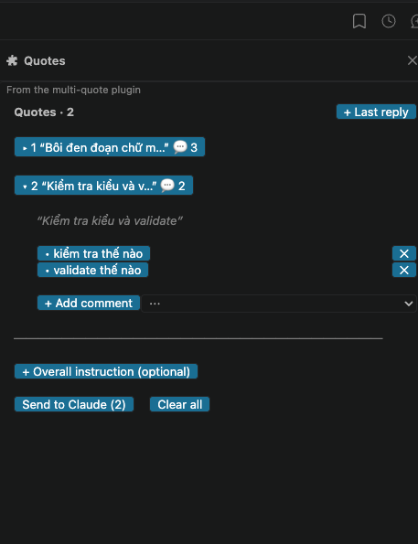

# multi-quote

Mod cho Claude Code, hoạt động giống "quote đoạn đã chọn" của ChatGPT nhưng quote được nhiều đoạn cùng lúc. Bạn chọn text trong câu trả lời của Claude, thêm mỗi đoạn thành một quote, viết comment cho từng quote, rồi gửi tất cả lại cho Claude trong một tin nhắn follow-up duy nhất. Tin nhắn đi như prompt của chính bạn, trong cùng session, nên Claude vẫn giữ nguyên ngữ cảnh. Mod không gửi gì ra ngoài hay cho bên thứ ba: xem [docs/privacy.md](docs/privacy.md).



## Bắt đầu nhanh

1. Dùng chuột chọn một đoạn trong câu trả lời của Claude.
2. Gõ `/quote` (text vẫn đang được chọn). Quote được thêm, pane **Quotes** mở ra với ô comment đầu tiên sẵn sàng.
3. Gõ comment, nhấn Enter để lưu. Lặp lại với các đoạn khác.
4. Bấm **Send to Claude** (hoặc gõ `/quote-send`). Composer được làm trống sau khi gửi.

Không chọn được text? Dùng `/quote <text>` hoặc `/quote-last` rồi sửa lại bằng **⋯ → Edit quote**.

## Cài đặt

```
/plugin install multi-quote --marketplace trungnn-1883/claude_mods
```

Hoặc từ shell:

```
claude plugin install multi-quote --marketplace trungnn-1883/claude_mods
```

Repo là public nên ai cũng cài được, không cần tài khoản hay quyền gì thêm. Cách cài từ thư mục local, gỡ mod và cập nhật: [docs/installation.md](docs/installation.md).

## Tài liệu

| File | Nội dung |
| --- | --- |
| [docs/installation.md](docs/installation.md) | Cài, gỡ, cập nhật, yêu cầu phiên bản, kiểm tra mod |
| [docs/usage.md](docs/usage.md) | Từng command, quy trình làm việc, nội dung tin nhắn gửi cho Claude, giới hạn |
| [docs/interface.md](docs/interface.md) | Pane Quotes: ảnh chụp, từng thành phần và thao tác khi bấm |
| [docs/examples.md](docs/examples.md) | Ba ví dụ từ đầu đến cuối, kèm nguyên văn tin nhắn gửi cho Claude |
| [docs/privacy.md](docs/privacy.md) | Dữ liệu đi đâu: mod không gửi gì ra ngoài, chỉ tin bạn bấm gửi mới tới Claude |

## Các file trong thư mục

- `.claude-plugin/plugin.json`: manifest của plugin
- `hooks/hooks.json`: trỏ tới module hook
- `hooks/register.tsx`: đăng ký các command
- `hooks/composer-pane.tsx`: giao diện pane Quotes
- `hooks/quote-actions.ts`: state của mod và các thao tác trên state (thêm, gửi, mở ô nhập)
- `hooks/quote-annotations.ts`: các thao tác thuần trên danh sách và cách dựng nội dung follow-up
- `hooks/command-record-trim.ts`: thu gọn mẩu giấy nhắn Claude Code ghi cho các lệnh `/quote…` để bớt token
- `hooks/transcript-index.ts`: ghi nhớ các câu trả lời đã hiện để tìm tin gốc của một quote
- `hooks/register.test.tsx`: test (11 test)
- `types/index.d.ts`: kiểu `QuoteAnnotation` và state `$.state` của mod
- `docs/`: tài liệu người dùng (xem bảng trên), ảnh chụp trong `docs/images/`
