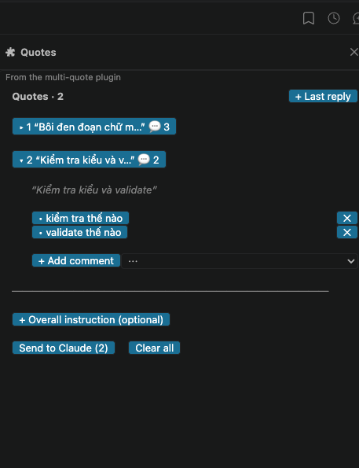

# Giao diện pane Quotes

Mục lục: [Bố cục](#bố-cục) · [Từng thành phần](#từng-thành-phần) · [Hành vi cần biết](#hành-vi-cần-biết) · [Mobile](#mobile)

Pane Quotes là nơi xem, comment và gửi các quote. Mở bằng `/quotes`, hoặc tự mở khi bạn thêm quote (nếu terminal đủ rộng). Cách dùng từng command: [usage.md](usage.md).

## Bố cục

Ảnh chụp trong VS Code: hai quote, quote 2 đang mở với hai comment, quote 1 đóng (có 3 comment).



Trên VS Code các nút là nút gốc của VS Code nên luôn có nền xanh. Sơ đồ dưới đây vẽ cùng bố cục dạng chữ, hai quote, quote 1 đang mở:

```
Quotes · 2                                    + Last reply

▾ 1  “Use a singleton for database conn…”  💬 2
     “Use a singleton for database connections.”   (nghiêng)

     • Do not use a singleton.                       ✕
     • Explain how the pool is sized.                ✕

     + Add comment                                   ⋯

▸ 2  “Cache every response for an hour.”   💬 0

────────────────────────────────────────────────
+ Overall instruction (optional)

[ Send to Claude (2) ]  Clear all
```

Khi chưa có quote nào, dòng gợi ý hiện ra: `Select text in a reply, then type /quote.`, header chỉ là `Quotes` và không có nút **Clear all**.

## Từng thành phần

| Thành phần | Hiển thị | Bấm vào thì |
| --- | --- | --- |
| Header `Quotes · N` | Số quote hiện có | Không làm gì |
| `+ Last reply` | Nút ở góc phải header | Thêm câu trả lời text gần nhất của Claude làm quote (giống `/quote-last`). Lỗi hiện dạng toast |
| Dòng quote `▸ N “tóm tắt…” 💬 k` | Số thứ tự, đoạn đầu quote rút gọn về một dòng, `k` là số comment đã viết | Mở quote (đổi thành `▾`). Bấm lại quote đang mở thì đóng |
| Text quote (khi mở) | Toàn văn quote, chữ nghiêng, mờ | Không làm gì |
| `No comments yet` | Hiện khi quote mở chưa có comment nào | Không làm gì |
| `• comment` | Mỗi comment là một nút, các comment cách nhau một dòng trống | Mở ô nhập để sửa comment đó |
| `✕` cạnh comment | Nút xóa | Xóa comment đó |
| Ô nhập comment | Placeholder `Your comment. Enter saves` | Enter hoặc nút **Save** lưu comment và đóng ô |
| `+ Add comment` | Nút dưới danh sách comment | Thêm một comment mới, mở ô nhập và focus sẵn |
| `⋯` (dropdown) | Menu của quote đang mở | Chọn một mục bên dưới |
| `Edit quote` | Mục trong `⋯` | Chuyển text quote thành ô nhập 3 dòng; Enter hoặc **save** lưu và quay lại dạng đọc |
| `Move up` / `Move down` | Mục trong `⋯` | Đổi chỗ quote lên hoặc xuống, số thứ tự đánh lại. Ở đầu/cuối danh sách thì không đổi gì |
| `Remove` | Mục trong `⋯` | Xóa quote, số thứ tự đánh lại |
| Đường kẻ ngang | Ngăn danh sách quote với phần gửi | Không làm gì |
| `+ Overall instruction (optional)` | Hiện khi chưa có instruction | Mở ô nhập (placeholder `Applies to every quote. Enter saves`); Enter lưu |
| `Instruction: …` | Hiện khi đã có instruction | Mở ô nhập để sửa |
| `Send to Claude (N)` | Nút chính, `N` là số quote | Gửi mọi quote và instruction cho Claude (giống `/quote-send`). Kết quả hiện dạng toast |
| `Clear all` | Chỉ hiện khi có ít nhất một quote | Xóa mọi quote, comment, instruction |

## Hành vi cần biết

- **Chỉ một quote mở tại một thời điểm.** Mở quote khác thì quote đang mở đóng lại, đồng thời đóng ô nhập và chế độ sửa text.
- **Quote mới tự mở**, và ô comment đầu tiên được focus sẵn: gõ được ngay.
- **Comment trống bị bỏ.** Mở ô comment rồi bỏ đó không nhập gì thì comment trống sẽ biến mất khi ô đóng; nó không hiện và không được gửi.
- **Xóa quote** cũng đóng ô nhập đang mở.
- **Gửi xong**, pane trở về trạng thái trống.

## Mobile

Mobile không có ô nhập text và dropdown, nên khác như sau:

| Thành phần | Trên mobile |
| --- | --- |
| Comment | Chỉ hiện dạng text `• comment`, không bấm để sửa, không có `✕` cạnh comment |
| `+ Add comment` | Không có |
| Menu `⋯` | Thay bằng ba nút `↑` (lên), `↓` (xuống), `✕` (xóa quote) |
| Edit quote | Không có |
| Overall instruction | Có hiện `Instruction: …` nếu đã có, nhưng không viết hay sửa được |

Vẫn xem danh sách, mở quote, đổi thứ tự, xóa và gửi được. Comment viết ở nơi khác sẽ được hiện và gửi đi bình thường.
