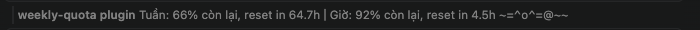

# weekly-quota

Mod cho Claude Code, hiện trên thanh trạng thái phần quota còn lại của tuần và của khung 5 giờ, kèm giờ reset, và một chú mèo chạy, ngủ, chơi len ở bên cạnh. Gõ `/cat` để bật hoặc tắt mèo.



## Bắt đầu nhanh

1. Cài mod (bên dưới), mở một phiên Claude Code mới.
2. Nhìn thanh trạng thái: `Tuần: 66% còn lại, reset in 64.7h │ Giờ: 92% còn lại, reset in 4.5h` và chú mèo.
3. Gõ `/cat` để tắt mèo, gõ lại để bật. Lựa chọn được nhớ cho các phiên sau.

Mod không gửi gì ra ngoài: xem [docs/privacy.md](docs/privacy.md).

## Cài đặt

```
/plugin install weekly-quota --marketplace trungnn-1883/claude_mods
```

Hoặc từ shell:

```
claude plugin install weekly-quota --marketplace trungnn-1883/claude_mods
```

Repo là public nên ai cũng cài được, không cần tài khoản hay quyền gì thêm. Cách cài từ thư mục local, gỡ mod và cập nhật: [docs/installation.md](docs/installation.md).

## Tài liệu

| File | Nội dung |
| --- | --- |
| [docs/installation.md](docs/installation.md) | Cài, gỡ, cập nhật, yêu cầu, kiểm tra mod |
| [docs/usage.md](docs/usage.md) | Lệnh `/cat`, khi nào số liệu cập nhật, khi nào không hiện gì |
| [docs/interface.md](docs/interface.md) | Ảnh chụp, cách đọc thanh trạng thái, năm hoạt động của mèo |
| [docs/privacy.md](docs/privacy.md) | Dữ liệu đi đâu: mod không gửi gì ra ngoài |

## Các file trong thư mục

- `.claude-plugin/plugin.json`: manifest của plugin
- `hooks/hooks.json`: trỏ tới module hook
- `hooks/register.ts`: đọc quota, dựng chữ trên thanh trạng thái, lệnh `/cat`
- `hooks/cat.ts`: chú mèo: các hoạt động, thời gian mỗi hoạt động, cách vẽ thành một dòng chữ
- `docs/`: tài liệu người dùng (xem bảng trên), ảnh chụp trong `docs/images/`
