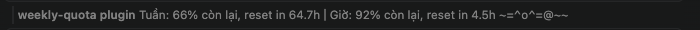

# Giao diện weekly-quota

Mod chỉ có một dòng trên thanh trạng thái của Claude Code, không có khung hay nút nào.

## Ảnh chụp

Trong VS Code, dòng của mod nằm ngay trên ô nhập prompt. Lúc chụp, mèo đang chơi cuộn len:



## Cách đọc

```
Tuần: 66% còn lại, reset in 64.7h │ Giờ: 92% còn lại, reset in 4.5h   ~=^o^=@~~
└──────────── quota tuần ────────┘ └──────── quota 5 giờ ─────────┘   └ mèo ┘
```

| Phần | Nghĩa |
| --- | --- |
| `Tuần: 66% còn lại` | Phần trăm quota 7 ngày còn lại (bằng 100 trừ phần đã dùng) |
| `reset in 64.7h` | Còn bao nhiêu giờ nữa thì khung đó reset |
| `│` | Ngăn hai khung quota |
| `Giờ: 92% còn lại` | Phần trăm quota của khung 5 giờ còn lại |
| `--` | Claude Code chưa báo số liệu của khung đó |
| Mèo | Cách phần quota ba khoảng trắng, chạy trong một vùng rộng 34 ký tự |

Trên terminal, thanh trạng thái nằm ở cuối màn hình; trên VS Code, ngay trên ô nhập prompt và có tên mod `weekly-quota plugin` đứng trước.

## Năm hoạt động của mèo

Mèo đổi hình khoảng ba lần mỗi giây. Mỗi hoạt động kéo dài ngẫu nhiên 8 đến 12 giây, rồi chuyển sang một hoạt động khác, không lặp lại hoạt động vừa xong.

| Hoạt động | Trông như | Mô tả |
| --- | --- | --- |
| Chạy | `~=^.^=` ⇄ `-=^o^=` | Chạy qua lại trong vùng 34 ký tự, đuôi `~` nằm phía sau theo hướng chạy, chạm mép thì quay đầu |
| Ngủ | `_=-.-= z` … `_=-.-= zzZZ` | Nằm yên, chữ `z` tăng dần |
| Chơi len | `~=^.^=  @~~` | Cuộn len `@` lăn qua lại trước mặt |
| Cào tường | `~=>.<=/` cạnh `\|` | Đi tới bức tường `\|` ở cuối vùng, rồi cào `/` `\` |
| Liếm chân | `~=^-^=c` | Ngồi liếm chân, `c` nhấp nháy |

Gõ `/cat` để mèo nghỉ hẳn: thanh trạng thái chỉ còn phần quota. Gõ lại để mèo chạy tiếp.
